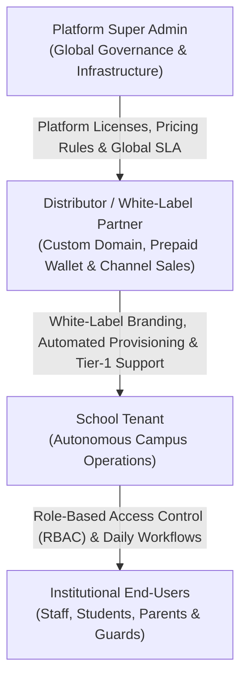
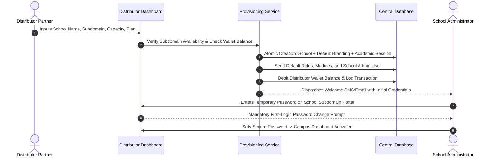
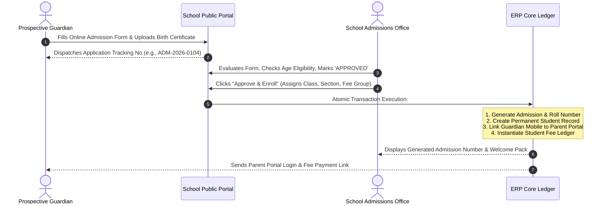
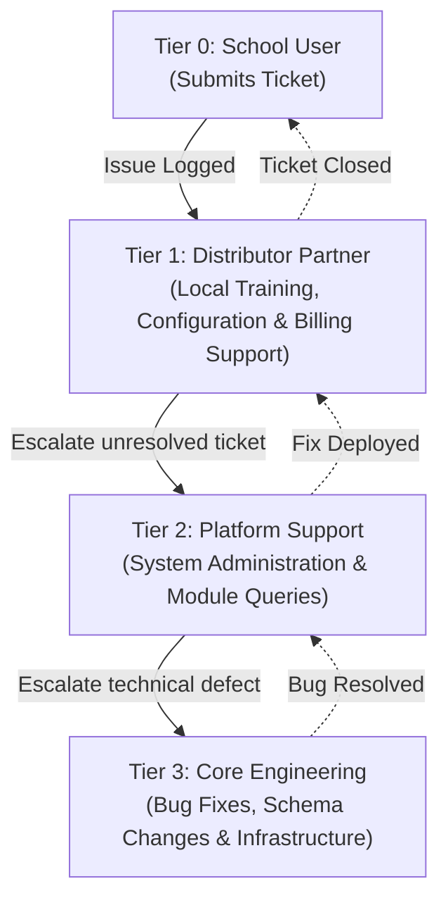

# Business Requirements Document (BRD)
## Multi-Tenant B2B2B School Management ERP SaaS Platform

---

### Document Control
- **Project Name:** Multi-Tenant B2B2B School ERP SaaS Platform
- **Document Version:** 2.0.0 (Comprehensive Feature Edition)
- **Document Status:** Official Baseline
- **Target Audience:** Executive Leadership, Business Partners, Regional Distributors, School Boards, Product Managers, System Architects

---

## Table of Contents
1. [Executive Summary & Strategic Vision](#1-executive-summary--strategic-vision)
2. [Business Objectives & Key Performance Indicators (KPIs)](#2-business-objectives--key-performance-indicators-kpis)
3. [Stakeholder Personas & Hierarchy](#3-stakeholder-personas--hierarchy)
4. [Commercial Architecture & Monetization Model](#4-commercial-architecture--monetization-model)
5. [End-to-End Business Workflows](#5-end-to-end-business-workflows)
6. [Detailed Business Requirements by Module](#6-detailed-business-requirements-by-module)
   - [Module 1: Multi-Tenancy, Subdomain Resolution & Access Governance](#module-1-multi-tenancy-subdomain-resolution--access-governance)
   - [Module 2: Distributor Partner Management & White-Label Reselling](#module-2-distributor-partner-management--white-label-reselling)
   - [Module 3: School Onboarding & 4-Step Tenant Provisioning](#module-3-school-onboarding--4-step-tenant-provisioning)
   - [Module 4: Institutional Branding, Seals & Custom Domain Verification](#module-4-institutional-branding-seals--custom-domain-verification)
   - [Module 5: Academic Structure, Classes & Student/Staff Directory](#module-5-academic-structure-classes--studentstaff-directory)
   - [Module 6: Multi-Child Parent Mapping & Family Portal](#module-6-multi-child-parent-mapping--family-portal)
   - [Module 7: Dry-Run Excel & CSV Bulk Data Import Engine](#module-7-dry-run-excel--csv-bulk-data-import-engine)
   - [Module 8: Student & Staff Daily Attendance Engine](#module-8-student--staff-daily-attendance-engine)
   - [Module 9: Fee Management, Fee Structures & Concessions](#module-9-fee-management-fee-structures--concessions)
   - [Module 10: Offline Counter Fee Collection & Sequential Receipts](#module-10-offline-counter-fee-collection--sequential-receipts)
   - [Module 11: Online Payment Gateway & Webhook Reconciliation](#module-11-online-payment-gateway--webhook-reconciliation)
   - [Module 12: School Day-Book & Daily Operational Expenditure](#module-12-school-day-book--daily-operational-expenditure)
   - [Module 13: Conflict-Checked Timetable Scheduling](#module-13-conflict-checked-timetable-scheduling)
   - [Module 14: Syllabus Progress & Weekly Curriculum Planning](#module-14-syllabus-progress--weekly-curriculum-planning)
   - [Module 15: Homework Desk & Digital Student Submissions](#module-15-homework-desk--digital-student-submissions)
   - [Module 16: Examination Planning, Marks Entry & Auto-Results Engine](#module-16-examination-planning-marks-entry--auto-results-engine)
   - [Module 17: Official School Certificates Desk (TC, Bonafide, Character)](#module-17-official-school-certificates-desk-tc-bonafide-character)
   - [Module 18: Dynamic Bulk PDF Generation (QR ID Cards, Admit Cards, Marksheets)](#module-18-dynamic-bulk-pdf-generation-qr-id-cards-admit-cards-marksheets)
   - [Module 19: Campus Gatepass & Visitor Safety Desk](#module-19-campus-gatepass--visitor-safety-desk)
   - [Module 20: Public Online Admissions Portal & 1-Click Enrollment](#module-20-public-online-admissions-portal--1-click-enrollment)
   - [Module 21: Transport Fleet Management & Distance-Based Fee Billing](#module-21-transport-fleet-management--distance-based-fee-billing)
   - [Module 22: Library Circulation & Barcode Auto-Fine Engine](#module-22-library-circulation--barcode-auto-fine-engine)
   - [Module 23: Inventory & Asset Management](#module-23-inventory--asset-management)
   - [Module 24: School Website CMS & Public Portal Aggregator](#module-24-school-website-cms--public-portal-aggregator)
   - [Module 25: Branded Mobile App Engine (Android APK & Play Store Bundles)](#module-25-branded-mobile-app-engine-android-apk--play-store-bundles)
   - [Module 26: Multi-Channel Communication & In-App Chat](#module-26-multi-channel-communication--in-app-chat)
   - [Module 27: 3-Tier Hierarchical Support Ticketing System](#module-27-3-tier-hierarchical-support-ticketing-system)
7. [Enterprise Business Rules & Compliance](#7-enterprise-business-rules--compliance)
8. [Assumptions, Dependencies & Risk Governance](#8-assumptions-dependencies--risk-governance)
9. [Sign-off & Approval Baseline](#9-sign-off--approval-baseline)

---

## 1. Executive Summary & Strategic Vision

### 1.1 Project Overview
The **Multi-Tenant B2B2B School Management ERP SaaS Platform** is an enterprise-grade cloud operating system engineered to digitize, unify, and automate administrative, academic, financial, safety, and communication operations across K-12 schools, multi-branch educational groups, and private academies.

Rather than selling standalone software licenses directly to individual schools, the platform introduces a **4-tier B2B2B hierarchy**:
```
Platform Super Admin (Cloud Operator)
  └── Distributor / White-Label Partner (Regional Resellers / Franchisees)
        └── School Tenant (Individual K-12 Campuses)
              └── End-User Personas (Principal, Accountant, Teacher, Student, Parent, Security)
```



### 1.2 Core Business Value
- **For Schools:** Eliminates administrative overhead by up to **70%**, automates fee collections, guarantees error-free marksheet and certificate generation, and elevates institutional reputation through custom-branded parent portals and mobile apps.
- **For Distributors:** Provides an instant, turn-key software business. Distributors set their own retail subscription pricing, brand the software under their private corporate identity, and retain guaranteed monthly commissions.
- **For Parents & Students:** Single-window transparent access to attendance, fee dues, report cards, homework, bus tracking, and communication from kindergarten through high school graduation.

---

## 2. Business Objectives & Key Performance Indicators (KPIs)

| Objective ID | Strategic Objective | Target Business KPI |
|---|---|---|
| **OBJ-01** | Zero-Touch School Onboarding | Provision a production-ready school campus with branding and admin account in **< 60 seconds**. |
| **OBJ-02** | Revenue Acceleration | Reduce outstanding school fee arrears by **35%** within 90 days of digital payment gateway deployment. |
| **OBJ-03** | Total Tenant Isolation | Maintain **100% data partition integrity** across competing institutions and distributor channels. |
| **OBJ-04** | Error-Free Academic Processing | Eliminate calculation errors in term GPA, percentage, and dense class ranking across 100,000+ students. |
| **OBJ-05** | Campus Safety Compliance | Enforce a **100% OTP-verified early student exit protocol** to eliminate unauthorized child pick-ups. |
| **OBJ-06** | System Availability & SLA | Guarantee **99.9% uptime** during morning attendance roll-calls, exam result declarations, and fee deadlines. |

---

## 3. Stakeholder Personas & Hierarchy

| Persona | Level | Business Responsibilities & Motivations |
|---|---|---|
| **Super Admin** | Platform Level | Oversees multi-tenant infrastructure, manages global subscription tiers, audits financial flows, and arbitrates L3 engineering escalations. |
| **Distributor Partner** | Reseller Level | Onboards regional schools, manages a prepaid credit wallet, sets retail pricing, handles Tier-1 customer support, and tracks Monthly Recurring Revenue (MRR). |
| **School Admin (Principal/Director)** | Campus Executive | Governs school configuration, academic calendar, staff appointments, student admissions, public website CMS, and campus policies. |
| **School Accountant** | Financial Desk | Sets up fee heads, collects counter fees, audits daily collections, manages petty cash expense vouchers, and reconciles gateway settlements. |
| **Teacher / Class Mentor** | Academic Desk | Records daily roll-call attendance, distributes homework, evaluates exams, tracks syllabus milestones, and communicates with guardians. |
| **Parent / Guardian** | Family Desk | Monitors academic progress of all children under one family login, pays tuition/transport fees online, and requests verified gatepasses. |
| **Student** | Learner Desk | Accesses daily schedule, reviews assignments, submits homework digitally, views exam results, and tracks library borrowings. |
| **Security Officer / Guard** | Safety Desk | Scans visitor IDs, verifies student early-exit gatepass OTP codes, and maintains the campus entry/exit log. |

---

## 4. Commercial Architecture & Monetization Model

### 4.1 B2B2B Revenue & Commission Mechanics
1. **Prepaid Distributor Wallet:**
   - Distributors fund an in-platform wallet (e.g., minimum deposit of ₹5,000).
   - Tenant creation and monthly school renewals automatically debit the distributor's wallet.
2. **Subscription Splitting:**
   - **Default Commission:** Distributor retains **30%** of school SaaS billing; Platform collects **70%**.
   - Custom revenue splits (e.g., 60/40 or 80/20) can be configured for enterprise high-volume distributors.
3. **Student Tier-Based Fair-Use Quotas:**
   - Schools are licensed based on active student capacity (e.g., Tier 1: 500 students, Tier 2: 1,500 students, Tier 3: Unlimited).
   - If a school exceeds its quota, the system triggers automated alerts to the distributor to initiate an upgrade.


### 4.2 Grace Periods & Delinquency Governance
- When a subscription expires, schools enter a **7-day Grace Period** with full access preserved.
- After 7 days of non-payment, non-essential services (CMS editing, bulk SMS, mobile app updates) are locked, while essential student and fee records remain in read-only mode to prevent academic disruption.

---

## 5. End-to-End Business Workflows

### 5.1 School Provisioning to First Login Workflow


### 5.2 1-Click Online Admission & Enrollment Workflow


---

## 6. Detailed Business Requirements by Module

---

### Module 1: Multi-Tenancy, Subdomain Resolution & Access Governance
- **Business Need:** A single cloud infrastructure must serve thousands of competing educational institutions without data leakage, performance degradation, or identity confusion.
- **Stakeholders:** Platform Super Admin, Distributor Partner, All School Users.

#### Business Requirements:
- **`BR-TEN-01` Subdomain Isolation:** Every school must be accessible via an independent subdomain (e.g., `greenwood.erpcloud.com`) or a verified custom domain (e.g., `erp.greenwoodhigh.edu`).
- **`BR-TEN-02` Tenant-Scoped Authentication:** A user logging in must be authenticated exclusively against the school linked to the current subdomain. Staff or students belonging to School A cannot authenticate on School B’s portal.
- **`BR-TEN-03` Data Boundary Enforcement:** Every database read, search, aggregate, update, and delete must be programmatically constrained by `school_id` and `distributor_id`.
- **`BR-TEN-04` Mandatory First-Login Password Policy:** All user credentials generated automatically must have a forced password reset flag (`mustChangePassword: true`), preventing unauthorized administrative account takeovers.
- **`BR-TEN-05` Session Invalidation:** Administrative password resets or account suspensions must immediately revoke active JWT sessions.

---

### Module 2: Distributor Partner Management & White-Label Reselling
- **Business Need:** Regional EdTech partners must be empowered to sell and manage software under their own brand name, colors, and legal identity.
- **Stakeholders:** Platform Super Admin, Distributor Partner.

#### Business Requirements:
- **`BR-DIST-01` White-Label Customization:** Distributors must be able to upload their own company logo, custom domain, primary/secondary brand colors, and "Powered by" footer copy across all their child schools.
- **`BR-DIST-02` Prepaid Wallet Ledger:** The platform must maintain a tamper-evident financial ledger tracking every wallet credit (bank transfer, PG deposit) and debit (school provisioning, monthly license renewals).
- **`BR-DIST-03` Automated Commission Engine:** The platform must automatically compute monthly distributor earnings based on the agreed revenue split (default: 30% distributor / 70% platform).
- **`BR-DIST-04` Automated Monthly Billing:** On the 1st of every calendar month, the system must generate detailed tax invoices per school detailing active student counts, unit tier rates, and total amounts due.
- **`BR-DIST-05` Delinquency Locking:** If a distributor's wallet balance is insufficient to cover recurring renewals after the grace period, child school administration features must automatically transition to `LOCKED` state.

---

### Module 3: School Onboarding & 4-Step Tenant Provisioning
- **Business Need:** School onboarding must be instant, automated, and free from manual technical setup or database provisioning delays.
- **Stakeholders:** Distributor Partner, School Administrator.

#### Business Requirements:
- **`BR-PROV-01` 60-Second Provisioning:** The provisioning wizard must complete campus setup in under 60 seconds across four atomic steps:
  1. *School Entity Creation:* Validates unique code, subdomain, official affiliation code, and address.
  2. *Branding Initialization:* Pre-populates default theme colors, logos, and placeholders.
  3. *Academic Session Setup:* Creates the initial active academic session (e.g., `2026-2027`) with valid start and end dates.
  4. *Admin Account Provisioning:* Generates primary administrator username and randomized temporary password.
- **`BR-PROV-02` Rollback on Failure:** If any provisioning step encounters a conflict (e.g., duplicate subdomain), the entire transaction must roll back cleanly with zero orphaned records.
- **`BR-PROV-03` Welcome Kit Dispatch:** Upon provisioning completion, the system must automatically email/SMS the primary school contact an onboarding welcome kit containing login URLs and administrator credentials.

---

### Module 4: Institutional Branding, Seals & Custom Domain Verification
- **Business Need:** Schools require strict visual identity compliance for official documents, report cards, ID cards, and public web portals.
- **Stakeholders:** School Administrator, Accountant, Public Visitors.

#### Business Requirements:
- **`BR-BRD-01` Brand Assets Repository:** The system must securely store school logos, watermarks, principal digital signatures, and official circular stamps.
- **`BR-BRD-02` Document Customization:** Marksheets, transfer certificates, fee receipts, and admit cards must automatically embed the school’s high-resolution crest, affiliation number, and principal's signature.
- **`BR-BRD-03` Institutional UPI Integration:** Schools must be able to configure their institutional UPI ID, merchant payee name, and merchant code for counter QR code printing.
- **`BR-BRD-04` Custom Domain Verification:** The platform must verify external custom domains using DNS TXT / CNAME verification before routing web traffic to the tenant.

---

### Module 5: Academic Structure, Classes & Student/Staff Directory
- **Business Need:** A unified directory is essential to organize campus hierarchy, track student lifecycle from entry to alumni, and maintain complete employee files.
- **Stakeholders:** School Administrator, Class Teachers, Administrative Clerks.

#### Business Requirements:
- **`BR-DIR-01` Academic Hierarchy:** The system must support an unlimited number of Classes (e.g., Grade 1 to 12) partitioned into Sections (e.g., A, B, C) with configurable student capacity limits.
- **`BR-DIR-02` Student Profile Records:** Each student profile must capture admission number, roll number, biometric ID, full name, date of birth, blood group, category, Aadhaar/national ID, emergency contacts, medical history, and passport photo.
- **`BR-DIR-03` Student Lifecycle Statuses:** The platform must maintain explicit lifecycle statuses: `ACTIVE`, `INACTIVE`, `PROMOTED`, `DETAINED`, `ALUMNI`, and `SUSPENDED`.
- **`BR-DIR-04` Staff Master Directory:** Tracks teaching and non-teaching personnel, qualification credentials, designation, date of joining, salary grade, emergency contacts, and assigned class mentorships.
- **`BR-DIR-05` Paginated Instant Search:** The directory must support instant searching across tens of thousands of records by student name, roll number, admission number, or father's mobile number.

---

### Module 6: Multi-Child Parent Mapping & Family Portal
- **Business Need:** Parents with multiple children enrolled in the same school must not be forced to maintain separate login accounts or pay fees through multiple sessions.
- **Stakeholders:** Parents, Guardians, School Administrator.

#### Business Requirements:
- **`BR-PAR-01` Mobile-Number Family Linkage:** The system must automatically link multiple siblings to a single `PARENT` user account based on the primary guardian mobile number.
- **`BR-PAR-02` One-Click Child Switcher:** The parent portal must provide an instant child switcher toggle, dynamically updating the active view (attendance, pending fees, homework, report cards) without re-logging in.
- **`BR-PAR-03` Combined Family Statements:** Parents must be able to view an itemized fee statement listing the combined dues and payment history across all their enrolled children.

---

### Module 7: Dry-Run Excel & CSV Bulk Data Import Engine
- **Business Need:** Migrating student and staff data from legacy systems or spreadsheets must be foolproof and protected against partial or corrupted data loads.
- **Stakeholders:** School Administrator, Data Entry Operators.

#### Business Requirements:
- **`BR-IMP-01` Dual Format Compatibility:** The import engine must natively parse both `.xlsx` (Apache POI) and `.csv` (OpenCSV) spreadsheet formats.
- **`BR-IMP-02` Two-Phase Dry-Run Protocol:**
  1. *Validation Phase (Dry-Run):* Evaluates every row against business rules (required fields, valid mobile numbers, date-of-birth formats, class existence, duplicate admission numbers). Zero database records are written.
  2. *Inspection Phase:* Displays an interactive summary table highlighting valid rows versus invalid rows with explicit error messages and row coordinates.
  3. *Commit Phase:* Only upon explicit user confirmation does the system commit valid rows inside a high-speed batch database transaction.
- **`BR-IMP-03` Automatic User Provisioning:** The commit phase must automatically generate associated student records, parent user accounts, and initial academic session enrollments.

---

### Module 8: Student & Staff Daily Attendance Engine
- **Business Need:** Timely attendance tracking reduces student truancy, enforces institutional discipline, and keeps guardians informed of unexcused absences.
- **Stakeholders:** Class Teachers, School Administrator, Parents.

#### Business Requirements:
- **`BR-ATT-01` One-Click Grid Roll-Call:** Teachers must be able to mark an entire class section in a fast grid view, defaulting all students to `PRESENT` and clicking only absent, late, or excused students.
- **`BR-ATT-02` Unique Daily Attendance Constraint:** The system must strictly disallow multiple attendance submissions for the same student on the same calendar date.
- **`BR-ATT-03` Automated Absenteeism Event:** Marking a student `ABSENT` must immediately fire a high-priority system notification to the linked guardian's parent portal and mobile app.
- **`BR-ATT-04` Staff Attendance Register:** Supports daily check-in, check-out, and leave recording (`CASUAL_LEAVE`, `SICK_LEAVE`, `DUTY_LEAVE`) for teaching and administrative personnel.
- **`BR-ATT-05` Muster Roll Analytics:** Generates monthly attendance muster rolls, calculates percentage attendance, and flags students falling below the mandatory statutory attendance threshold (e.g., < 75%).

---

### Module 9: Fee Management, Fee Structures & Concessions
- **Business Need:** Educational institutions require flexible fee structures accommodating different grades, frequencies, sibling discounts, and scholarships.
- **Stakeholders:** School Accountant, School Administrator.

#### Business Requirements:
- **`BR-FEE-01` Modular Fee Heads:** Supports custom fee components including Tuition Fee, Development Fee, Examination Fee, Laboratory Fee, Transport Fee, and Annual Amenities.
- **`BR-FEE-02` Flexible Installment Schedules:** Allows configuring billing frequencies: Monthly, Quarterly, Bi-Annual, or Annual payment installments with configurable due dates.
- **`BR-FEE-03` Concession & Discount Engine:** Accommodates categorized fee discounts:
  - *Merit / Scholarship:* Percentage or fixed amount reduction.
  - *Sibling Concession:* Automatic or manual discount applied to second/third child.
  - *Staff Ward Concession:* Concession allocated to children of institutional employees.
- **`BR-FEE-04` Dynamic Ledger Generation:** Enrolling a student automatically instantiates an active `student_fee_ledger` detailing total debits, paid credits, and balance due.

---

### Module 10: Offline Counter Fee Collection & Sequential Receipts
- **Business Need:** Front-desk fee counters must process cash, check, and POS payments rapidly, print dual-copy receipts, and maintain a 100% auditable trail.
- **Stakeholders:** School Accountant, Parents.

#### Business Requirements:
- **`BR-REC-01` Multi-Mode Counter Collection:** The fee counter must support payments made via Cash, Cheque, Demand Draft, Debit/Credit POS Card, and Counter UPI QR scan.
- **`BR-REC-02` Tamper-Evident Sequential Receipt Numbers:** Every receipt issued must possess an auto-incrementing, contiguous sequential receipt number scoped to the school and financial year (e.g., `RCP-2026-0042`).
- **`BR-REC-03` Dual-Copy Instant Printout:** The system must generate a professional, print-ready receipt containing an *Office Copy* and a *Parent Copy* on a single A4 or thermal receipt format.
- **`BR-REC-04` Cheque Clearance Workflow:** Cheque payments must be recorded in `PENDING_CLEARANCE` state and transition to `CLEARED` only after bank realization. If bounced, the system re-opens the fee balance and applies a penalty charge.
- **`BR-REC-05` Payment Correction Desk:** No fee transaction can ever be deleted. In the event of clerical error, accountants must create an audited `Payment Correction` record with mandatory administrative justification.

---

### Module 11: Online Payment Gateway & Webhook Reconciliation
- **Business Need:** Parents require 24/7 self-service fee payment options, while the school requires automated bank reconciliation without manual receipt posting.
- **Stakeholders:** Parents, School Accountant, Platform Administrator.

#### Business Requirements:
- **`BR-PG-01` Multi-Channel Digital Checkout:** The parent portal must support instant payments via UPI Apps (Google Pay, PhonePe, Paytm), Netbanking, Credit Cards, and Debit Cards.
- **`BR-PG-02` Dynamic Order Creation:** The system must create an encrypted gateway payment order (Razorpay / Cashfree) locking the exact balance amount to prevent partial tampering.
- **`BR-PG-03` Webhook Cryptographic Verification:** Payment capture notifications must be accepted only after verifying the webhook payload's cryptographic HMAC-SHA256 signature using the school's private secret.
- **`BR-PG-04` Zero-Touch Instant Settlement:** Upon valid signature verification, the system must atomically:
  1. Mark the student fee ledger balance as paid.
  2. Generate a valid sequential electronic receipt.
  3. Send an instant payment confirmation SMS and push notification to the parent.
- **`BR-PG-05` Idempotent Processing:** Webhook events must be idempotent; receiving multiple duplicate webhooks for the same order must never double-credit a student's ledger.

---

### Module 12: School Day-Book & Daily Operational Expenditure
- **Business Need:** The campus administration must maintain a real-time record of all operational cash inflows and outflows without requiring third-party accounting packages.
- **Stakeholders:** School Accountant, Principal / Management Board.

#### Business Requirements:
- **`BR-DAY-01` Non-Fee Revenue Tracking:** Captures ancillary institutional income including prospectus sales, school hall rentals, uniform store royalties, and canteen leases.
- **`BR-DAY-02` Expense Voucher Registry:** Records daily operational campus expenditures across standardized categories: `STAFF_SALARY`, `ELECTRICITY_WATER`, `REPAIRS_MAINTENANCE`, `STATIONERY_PRINTING`, and `EVENT_EXPENSES`.
- **`BR-DAY-03` Supporting Voucher Attachments:** Expense entries must support digital uploads of vendor cash memos, bills, and payment vouchers.
- **`BR-DAY-04` Real-Time Net Cash Flow:** The day-book dashboard must present real-time daily metrics:
  $$\text{Net Closing Balance} = \text{Opening Balance} + \text{Fee Collections} + \text{Non-Fee Income} - \text{Total Expense Vouchers}$$
- **`BR-DAY-05` Daily Cash Closing Lock:** At the end of each business day, the accountant must close the day-book, locking past vouchers against retroactive alteration.

---

### Module 13: Conflict-Checked Timetable Scheduling
- **Business Need:** Scheduling academic timetables manually results in teacher clashes, room double-booking, and uneven period distributions.
- **Stakeholders:** Academic Coordinator, Class Teachers, Students.

#### Business Requirements:
- **`BR-TT-01` Conflict-Free Scheduling Engine:** The system must evaluate timetable assignments in real time and strictly block overlapping allocations:
  - *Teacher Clash:* Prevents allocating Teacher A to multiple classes in the same period on the same day.
  - *Classroom Clash:* Prevents allocating multiple subjects or teachers to the same section in the same period.
- **`BR-TT-02` Multi-Dimensional Views:** The timetable module must provide three synchronized visual schedule views:
  1. *Class View:* Complete weekly period schedule for a specific class and section.
  2. *Teacher View:* Master weekly schedule for a teacher across all assigned classes.
  3. *Room / Lab View:* Usage schedule for science labs, computer halls, and sports grounds.
- **`BR-TT-03` Substitution Planner:** When a faculty member is marked on leave, the system must highlight available unassigned teachers during that period for one-click proxy substitution.

---

### Module 14: Syllabus Progress & Weekly Curriculum Planning
- **Business Need:** Academic leadership must monitor whether teachers are on pace to complete the approved curriculum before term examinations.
- **Stakeholders:** Principal, Academic Supervisors, Teachers.

#### Business Requirements:
- **`BR-SYL-01` Curriculum Structure Breakdown:** Teachers must be able to break down subject curriculum into Units, Chapters, and Estimated Teaching Periods.
- **`BR-SYL-02` Milestone Status Updates:** Teachers update chapter statuses: `PLANNED`, `IN_PROGRESS`, and `COMPLETED` along with actual completion dates.
- **`BR-SYL-03` Principal Progress Monitor:** The administrative dashboard must display a progress bar per subject, alerting management to subjects lagging more than 15% behind the academic calendar schedule.

---

### Module 15: Homework Desk & Digital Student Submissions
- **Business Need:** Homework assignments must be clearly documented to avoid communication lapses between teachers, students, and parents.
- **Stakeholders:** Teachers, Students, Parents.

#### Business Requirements:
- **`BR-HW-01` Assignment Dispatch:** Teachers publish daily assignments specifying class, section, subject, submission deadline, instructions, and reference attachments (PDFs, worksheets, images).
- **`BR-HW-02` Parent Notification:** Publishing a homework assignment dispatches an instant notification to parents and updates the student's daily assignment dashboard.
- **`BR-HW-03` Digital Student Submissions:** Students or parents can upload homework responses (scanned handwritten pages, text notes) directly through the portal prior to the deadline.
- **`BR-HW-04` Teacher Evaluation & Feedback:** Teachers can review submitted work online, assign marks/grades, write pedagogical feedback notes, and mark status as `CHECKED` or `RESUBMIT`.

---

### Module 16: Examination Planning, Marks Entry & Auto-Results Engine
- **Business Need:** Examination score recording, grading, and ranking require absolute precision, strict deadlines, and automated pass/fail validation.
- **Stakeholders:** Exam In-Charge, Subject Teachers, School Administrator, Parents.

#### Business Requirements:
- **`BR-EXAM-01` Exam Term & Assessment Setup:** Supports configuring multiple terms (e.g., Unit Test 1, Mid-Term Examination, Annual Final) with start dates, end dates, and subject schedules.
- **`BR-EXAM-02` Bulk Marks Entry with Validation:**
  - Subject teachers enter theory, practical, and internal marks in a tabular class roster.
  - The system strictly blocks entries exceeding the configured maximum marks (e.g., entering 85 when maximum is 80).
- **`BR-EXAM-03` Configurable Grading Scale:** Matches total student scores against the institutional grading scale (e.g., CBSE 9-point scale: `A1`, `A2`, `B1`... or GPA 4.0/10.0 scale).
- **`BR-EXAM-04` Automated Result Engine (`POST /calculate-results`):**
  - Evaluates individual subject pass criteria; marks student as `FAILED` or `COMPARTMENT` if any mandatory subject score falls below minimum threshold.
  - Computes cumulative percentage, overall division (1st / 2nd / 3rd), and total marks obtained.
  - Computes **Dense Class Ranking** (e.g., two top students with 98% both receive Rank 1, next student receives Rank 2).
- **`BR-EXAM-05` Publication Lock:** When the administrator publishes examination results, all marks entries are permanently locked against further tampering.

---

### Module 17: Official School Certificates Desk (TC, Bonafide, Character)
- **Business Need:** Issuing statutory certificates (Transfer Certificates, Bonafide Certificates) requires legal verification, anti-forgery serial numbering, and clear fee clearance checks.
- **Stakeholders:** School Administrator, Office Clerks, Passing-out Students.

#### Business Requirements:
- **`BR-CERT-01` Statutory Certificate Types:** Supports one-click generation of:
  - *Transfer Certificate (TC):* Mandates reason for leaving, conduct remarks, and date of application.
  - *Bonafide Certificate:* Confirms active student enrollment for passport or visa applications.
  - *Character Certificate:* Official testimonial of student discipline and behavior.
- **`BR-CERT-02` Dues Clearance Gate:** The system must block issuing a Transfer Certificate if the student has pending financial dues on their fee ledger, unless an explicit administrative waiver is granted.
- **`BR-CERT-03` Unique Serial Numbering:** Every certificate must bear a non-repeating official serial number (e.g., `TC-2026-0019`) recorded in a tamper-evident issuance register.
- **`BR-CERT-04` Duplicate Prevention:** If a duplicate copy of a certificate is requested, the system must watermark the document with `DUPLICATE COPY` and document the justification.

---

### Module 18: Dynamic Bulk PDF Generation (QR ID Cards, Admit Cards, Marksheets)
- **Business Need:** Schools spend large sums outsourcing printing of student ID cards, admit cards, and report cards. The platform must generate high-resolution, print-ready documents in-house.
- **Stakeholders:** School Administrator, Class Teachers, Students.

#### Business Requirements:
- **`BR-PDF-01` CR80 Plastic ID Cards:**
  - Formatted strictly to standard ISO CR80 plastic card specifications (85.6mm × 54mm).
  - Dynamically embeds student photo, blood group, emergency phone, school crest, and principal's signature.
  - Generates an encrypted **ZXing QR Code** linking to a public verification endpoint.
- **`BR-PDF-02` Examination Admit Cards:**
  - Generates batch admit cards containing student roll number, candidate photograph, room/desk allocation, complete exam schedule with dates/times, and examination rules.
- **`BR-PDF-03` Comprehensive Academic Marksheets:**
  - Generates professional A4 terminal report cards detailing subject scores, grade points, attendance percentages, teacher remarks, class rank, and institutional seals.
- **`BR-PDF-04` Batch Headless PDF Rendering:** Bulk generation for 500+ students must run in headless background threads without memory exhaustion or browser freezing.

---

### Module 19: Campus Gatepass & Visitor Safety Desk
- **Business Need:** Safeguarding student perimeter security requires preventing unauthorized child pickups and logging all external visitors entering campus premises.
- **Stakeholders:** Security Guards, School Administration, Parents.

#### Business Requirements:
- **`BR-GATE-01` OTP-Verified Student Early Exit:**
  - When an authorized guardian requests an early student pickup, the system sends a 6-digit cryptographic OTP to the guardian’s registered mobile phone.
  - The security officer must verify the OTP in the security terminal before authorizing physical exit.
- **`BR-GATE-02` Visitor Entry Registry:**
  - Logs visitor name, contact phone, purpose of visit, person to meet, vehicle number, and check-in timestamp.
  - Issues a printable visitor badge with barcode/QR code.
- **`BR-GATE-03` Real-Time On-Campus Visitor Count:** The security dashboard must display the exact count and list of external visitors currently on campus who have not checked out.

---

### Module 20: Public Online Admissions Portal & 1-Click Enrollment
- **Business Need:** Schools need a modern online admissions pipeline to attract prospective parents and eliminate paper-based application handling.
- **Stakeholders:** Prospective Parents, Admissions Office, School Principal.

#### Business Requirements:
- **`BR-ADM-01` Branded Public Application Portal:** Prospective parents submit applications directly on the school's public portal (`/apply`), uploading applicant photos, birth certificates, and prior report cards.
- **`BR-ADM-02` Application Tracking:** Parents receive an instant application number (e.g., `ADM-2026-0055`) enabling them to track status (`SUBMITTED`, `UNDER_REVIEW`, `INTERVIEW_SCHEDULED`, `APPROVED`, `REJECTED`).
- **`BR-ADM-03` Admissions Review Desk:** Admissions staff can schedule entrance assessments, record panel interview scores, and approve qualified candidates.
- **`BR-ADM-04` 1-Click Atomic Enrollment:**
  - Clicking "Approve & Enroll" executes a single atomic transaction:
    1. Creates the permanent student record with next available Admission Number.
    2. Assigns Class, Section, and Roll Number.
    3. Provisions or links the Parent user account.
    4. Initializes student fee ledger with the selected term fee structure.
    5. Dispatches welcome credentials to parent mobile and email.

---

### Module 21: Transport Fleet Management & Distance-Based Fee Billing
- **Business Need:** Managing school buses, routes, and student pick-up stops requires strict accountability and automated transportation fee billing.
- **Stakeholders:** Transport Manager, Accountant, Parents.

#### Business Requirements:
- **`BR-TRN-01` Vehicle & Driver Registry:** Tracks buses/vans, registration numbers, vehicle fitness certificate expiry, insurance validity, driver names, and emergency contact numbers.
- **`BR-TRN-02` Route & Pickup Stop Hierarchy:** Defines bus routes partitioned into sequential pick-up stops, morning pickup times, afternoon drop times, and monthly transport charges.
- **`BR-TRN-03` Vehicle Capacity Monitoring:** The system must prevent over-allocating students to a bus beyond its licensed seating capacity.
- **`BR-TRN-04` Automated Transport Fee Billing:** Mapping a student to a transport stop automatically injects the corresponding transport fee component into that student's regular fee ledger for the billing cycle.

---

### Module 22: Library Circulation & Barcode Auto-Fine Engine
- **Business Need:** Book checkout and return must be automated via barcode scanning to eliminate lost inventory and recover overdue fines.
- **Stakeholders:** School Librarian, Students, Teachers.

#### Business Requirements:
- **`BR-LIB-01` Barcode Book Cataloging:** Books are cataloged with ISBN, Title, Author, Publisher, Edition, Shelf/Rack Location, and a unique scanned Barcode identifier.
- **`BR-LIB-02` One-Scan Circulation:**
  - *Checkout:* Librarian scans student ID card barcode, then book barcode to issue book for a standard 14-day borrowing window.
  - *Checkin:* Librarian scans book barcode to complete return.
- **`BR-LIB-03` Automated Overdue Fine Engine:**
  - If returned after the 14-day window, the system automatically computes overdue fines based on the configured daily rate (e.g., ₹5.00 / day).
  - The accrued fine is automatically debited to the student’s financial account until collected.
- **`BR-LIB-04` Borrowing Limits:** Restricts checkout if student has reached the maximum permitted book count (e.g., 3 books) or has unpaid overdue fines.

---

### Module 23: Inventory & Asset Management
- **Business Need:** School equipment, science lab apparatus, stationery, and uniforms must be audited to prevent loss and automate vendor replenishment.
- **Stakeholders:** Store Manager, Administrative Officer, Department Heads.

#### Business Requirements:
- **`BR-INV-01` Multi-Category Stock Catalog:** Manages inventory items categorized by `UNIFORM`, `STATIONERY`, `LAB_EQUIPMENT`, `SPORTS_GOODS`, and `FURNITURE_ASSETS`.
- **`BR-INV-02` Tamper-Evident Stock Transactions:** Every stock movement must be recorded in an immutable ledger under one of five movement types:
  1. `PURCHASE`: Adding new stock received from vendor invoice.
  2. `ISSUE`: Releasing consumables or equipment to staff/department.
  3. `SALE`: Dispensing uniforms or textbooks to students.
  4. `RETURN`: Returning undamaged equipment back to inventory.
  5. `DAMAGED_WRITE_OFF`: Writing off broken or unusable items with mandatory remarks.
- **`BR-INV-03` Low-Stock Automated Alerts:** When current available quantity drops below the item's configured `lowStockThreshold`, the system triggers an administrative re-order alert.

---

### Module 24: School Website CMS & Public Portal Aggregator
- **Business Need:** Schools need a responsive, professional public website without depending on third-party web agencies or recurring webmaster fees.
- **Stakeholders:** School Administrator, Public Visitors, Prospective Parents.

#### Business Requirements:
- **`BR-CMS-01` No-Code Homepage Visual Editor:** Allows school administrators to update:
  - Hero banner imagery, primary slogan, and mission statement.
  - Principal's welcome message and portrait photo.
  - Photo gallery showcasing campus events and sports facilities.
  - Public noticeboard for announcements, tenders, and circulars.
  - Direct call-to-action button routing to the Online Admissions Portal.
- **`BR-CMS-02` Search Engine Optimization (SEO):** Allows configuring custom `metaTitle`, `metaDescription`, `metaKeywords`, and OpenGraph social preview images.
- **`BR-CMS-03` AI Search Crawler Support:** Includes an `allowAiCrawlers` configuration flag enabling discovery and summarization by modern generative AI search engines.

---

### Module 25: Branded Mobile App Engine (Android APK & Play Store Bundles)
- **Business Need:** Providing a school-branded Android app in the Google Play Store elevates school prestige and improves parent engagement.
- **Stakeholders:** School Administrator, Platform Super Admin, Parents.

#### Business Requirements:
- **`BR-MOB-01` In-Browser App Studio:** Allows the school administrator to configure:
  - App Name (e.g., "DPS Noida Mobile").
  - Android Package Name (e.g., `com.dpsnoida.portal`).
  - Target Audience: `PARENT_ONLY`, `TEACHER_ONLY`, or `ALL_IN_ONE`.
  - App Icon and Splash Screen background colors.
- **`BR-MOB-02` Automated Android Packaging:** The backend triggers automated packaging scripts compiling:
  - Direct installable `.apk` file for testing or manual distribution.
  - Production-ready Google Play Store `.aab` (Android App Bundle).
- **`BR-MOB-03` Super Admin Publishing Review:** App build requests are queued for Super Admin compliance review before release to verify app store guideline adherence.

---

### Module 26: Multi-Channel Communication & In-App Chat
- **Business Need:** Urgent school notices, weather alerts, and academic updates must reach guardians immediately via push notifications, SMS, and in-app feeds.
- **Stakeholders:** Principal, Teachers, Parents, Students.

#### Business Requirements:
- **`BR-COMM-01` Role-Targeted Circulars:** Allows publishing notices targeted to:
  - `ALL_SCHOOL` (entire community).
  - `TEACHERS_ONLY` (internal faculty circulars).
  - `PARENTS_ONLY` (general guardian updates).
  - `CLASS_SPECIFIC` (notices targeted to specific grades/sections).
- **`BR-COMM-02` 1-to-1 Teacher-Parent Messaging:**
  - Enables private chat threads between class teachers and parents.
  - Chat threads are archived, auditable by the school principal, and can be disabled during non-school hours.
- **`BR-COMM-03` Event-Driven Notifications:** Asynchronously triggers alerts upon:
  - Student marked absent during morning roll call.
  - Fee receipt generated upon successful payment.
  - Term examination marksheet published.
  - Student early-exit gatepass generated.

---

### Module 27: 3-Tier Hierarchical Support Ticketing System
- **Business Need:** Technical, operational, or billing inquiries must be resolved efficiently through structured escalation workflows.
- **Stakeholders:** School Staff, Distributor Support, Platform Engineering.



#### Business Requirements:
- **`BR-SUP-01` Structured Ticket Logging:** Schools log tickets specifying category (`FEE_ISSUE`, `ATTENDANCE_BUG`, `IMPORT_ERROR`, `BILLING`), priority (`LOW`, `MEDIUM`, `HIGH`, `CRITICAL`), and description with attachments.
- **`BR-SUP-02` Tier-1 Distributor Routing:** Tickets automatically route to the school’s assigned Distributor Partner for immediate frontline resolution.
- **`BR-SUP-03` Tier-2 & Tier-3 Escalation:** If the distributor cannot resolve the inquiry, they can escalate the ticket with full history to Platform Operations (Tier-2) or Core Engineering (Tier-3).
- **`BR-SUP-04` SLA & Resolution Tracking:** The system enforces SLA resolution timers based on priority and sends status update notifications upon each state transition (`OPEN` → `IN_PROGRESS` → `RESOLVED` → `CLOSED`).

---

## 7. Enterprise Business Rules & Compliance

### 7.1 Multi-Tenant Data Protection
- **`BR-COMP-01` Cross-Tenant Zero Knowledge:** Under no circumstance shall any SQL query, stored procedure, search index, or API payload allow data from one school to be accessed by another.
- **`BR-COMP-02` Tenant-Scoped File Storage:** Uploaded identity documents, student photos, and fee receipts must be partitioned into tenant-specific filesystem directories (`./uploads/{schoolId}/...`).

### 7.2 Financial Immutability & Audit Trails
- **`BR-COMP-03` Tamper-Evident Ledgers:** No fee transaction or issued receipt can be hard-deleted from the database. Any corrections must take the form of explicit contra-entries with documented supervisor approvals.
- **`BR-COMP-04` Gateway Reconciliation Guarantee:** An online fee transaction is considered complete only after cryptographic verification of the payment gateway signature.

### 7.3 Student Privacy & Safety
- **`BR-COMP-05` Minor Data Privacy:** Student biometric data, medical logs, and identity numbers must be protected by encrypted transit (TLS 1.3) and restricted RBAC access.
- **`BR-COMP-06` Safe Exit Protocol:** No student shall be released early from school grounds without a verified 6-digit OTP dispatched to the registered guardian's phone number.

---

## 8. Assumptions, Dependencies & Risk Governance

### 8.1 Critical Assumptions
1. School administrative staff and teachers have access to desktop computers or tablets connected to the internet.
2. Parents have access to SMS or web-enabled smartphones to receive fee receipts, attendance alerts, and OTPs.
3. The school administration is authorized under local educational laws to store student and parent academic records in cloud infrastructure.

### 8.2 External Dependencies
- **Payment Gateway:** Razorpay / Cashfree merchant credentials required for online digital fee collection.
- **Cloudflare / DNS Reverse Proxy:** Required for SSL wildcard routing and custom domain mapping.
- **SMS / WhatsApp Gateway:** Required for out-of-band delivery of OTP gatepass codes and urgent absent notifications.

### 8.3 Risk Assessment Matrix

| Risk Code | Risk Event | Impact | Likelihood | Mitigation Strategy |
|---|---|---|---|---|
| **`RSK-01`** | Accidental data leakage between competing schools. | **Critical** | Low | Enforce Spring Security `@PreAuthorize` combined with Hibernate `@FilterDef("tenantFilter")` on every repository query. |
| **`RSK-02`** | Payment gateway network drop during parent checkout. | **High** | Medium | Asynchronous webhook listener automatically processes captured payments and generates receipts even if parent browser disconnects. |
| **`RSK-03`** | Upload of corrupted student Excel rosters. | **Medium** | High | Implement two-phase **Dry-Run Import Engine** (Dry-Run Validate → Review Discrepancies → Atomic Commit). |
| **`RSK-04`** | Morning attendance server load spikes. | **Medium** | High | Attendance queries leverage composite database indexes `(school_id, class_id, date)` with asynchronous event dispatch for parent alerts. |

---

## 9. Sign-off & Approval Baseline

| Stakeholder Role | Representative Name | Organization / Division | Sign-off Status | Date |
|---|---|---|---|---|
| **Platform Sponsor** | Chief Executive Officer | SaaS Platform Core | **APPROVED** | 2026-10-26 |
| **Technical Architect** | Chief Technology Officer | Engineering Operations | **APPROVED** | 2026-10-26 |
| **Channel Alliances** | VP of Distributor Sales | Partner Ecosystem | **APPROVED** | 2026-10-26 |
| **Academic Advisory** | Board Representative | K-12 Educational Alliance | **APPROVED** | 2026-10-26 |
