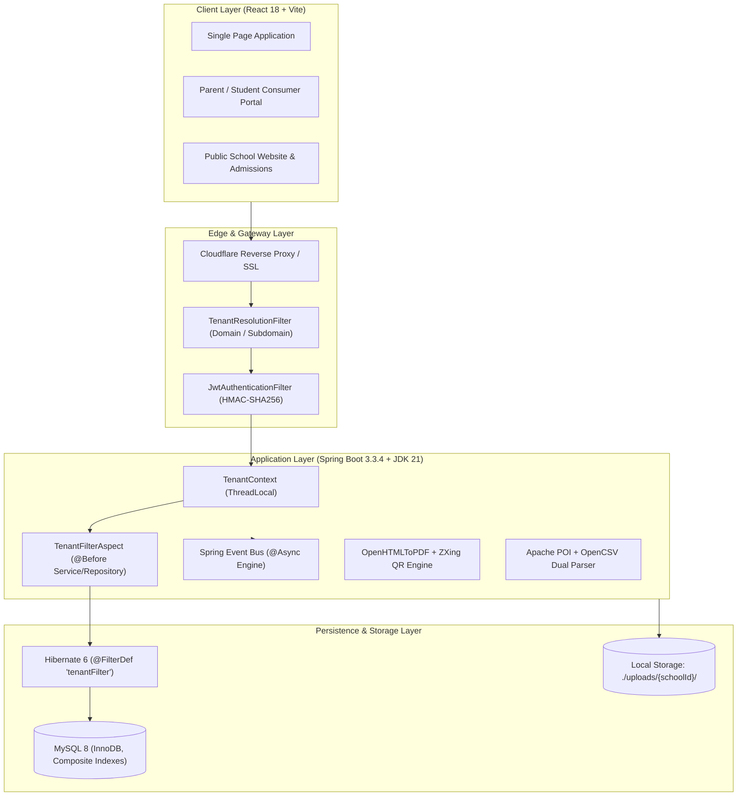
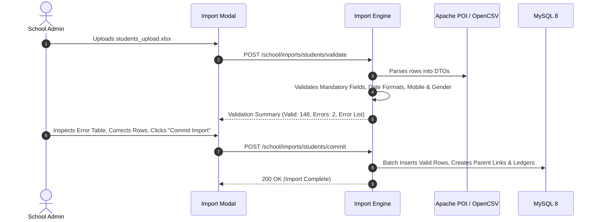
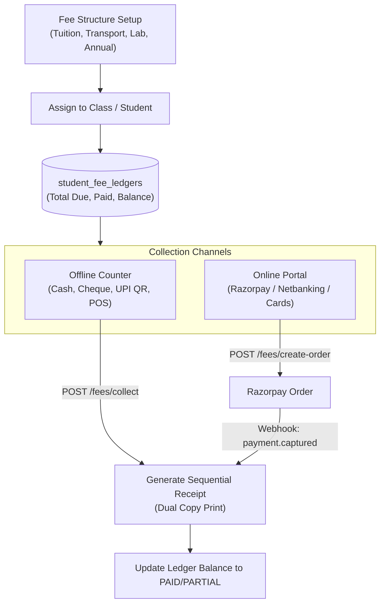
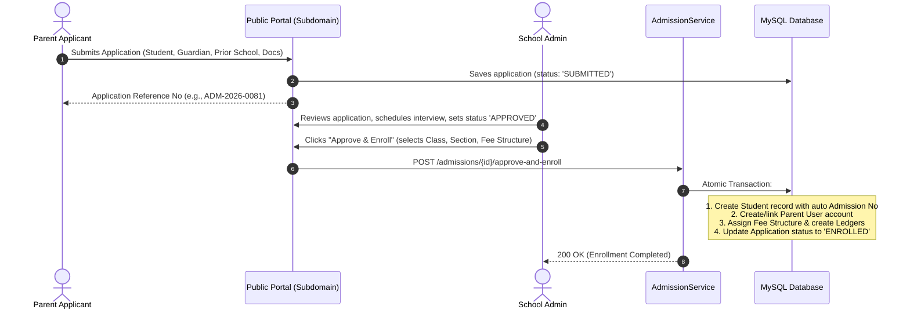
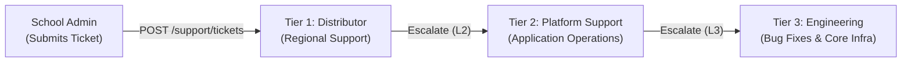

# Functional Requirements Document (FRD)
## Multi-Tenant B2B2B School Management ERP SaaS Platform

---

### Document Control
- **Project Name:** Multi-Tenant B2B2B School ERP SaaS Platform
- **Document Version:** 1.0.0
- **Document Status:** Official Baseline
- **Target Audience:** Software Engineers, QA Engineers, DevOps, Solution Architects, Product Owners

---

## 1. System Overview & Technology Stack

The platform is designed as a cloud-native, multi-tenant B2B2B software-as-a-service application. It utilizes a unified single-database, tenant-discriminator architecture enforced at the persistence layer.



### 1.1 Core Technology Stack

| Component | Technology | Version | Purpose |
|---|---|---|---|
| **Runtime** | Java Development Kit (JDK) | 21 (LTS) | Virtual threads, modern language features, high throughput |
| **Backend Framework** | Spring Boot | 3.3.4 | Core dependency injection, REST APIs, security, transactions |
| **Security** | Spring Security + JJWT | 0.12.6 | JWT token authentication, stateless RBAC authorization |
| **Persistence / ORM** | Spring Data JPA / Hibernate | 6.5.x | ORM mapping, automated query filtering with `@Filter` |
| **Database** | MySQL Server | 8.0+ | Relational data persistence with InnoDB engine |
| **Schema Migrations** | Flyway | 10.x | Version-controlled, deterministic SQL database migrations |
| **Frontend Framework** | React + TypeScript + Vite | 18.x / 5.x | High-performance SPA with Tailwind CSS & Lucide icons |
| **Document Engine** | OpenHTMLToPDF + ZXing | 1.0.10 / 3.5.3 | Headless HTML5-to-PDF rendering and QR barcode generation |
| **Spreadsheet Engine** | Apache POI + OpenCSV | 5.2.5 / 5.9 | High-performance Excel (.xlsx) and CSV parsing/validation |
| **Payment Gateway** | Razorpay SDK | 1.4.6 | Online order generation and HMAC-SHA256 webhook validation |

---

## 2. User Roles & Role-Based Access Control (RBAC) Matrix

The system enforces strict method-level authorization using Spring Security `@PreAuthorize("hasRole('...')")`:

| System Role | Scope | Key Capabilities |
|---|---|---|
| `SUPER_ADMIN` | Global Platform | Manage distributors, monitor SaaS subscriptions, access global server health, configure system plans. |
| `DISTRIBUTOR_ADMIN` | Distributor Scope | White-label portal settings, provision schools, manage prepaid wallet, handle L1 tickets. |
| `SCHOOL_ADMIN` | School Tenant Scope | Full administrative control of school settings, academic sessions, staff, classes, CMS, and reports. |
| `ACCOUNTANT` | School Tenant Scope | Fee structure assignment, counter fee collection, receipt generation, day-book expenses, refund audit. |
| `TEACHER` | School Tenant Scope | Class roll-call attendance, homework assignment, grading, exam marks entry, 1:1 chat with parents. |
| `PARENT` | Multi-Child Scope | Switch between enrolled children, view attendance, pay fees online, request early gatepasses, view notices. |
| `STUDENT` | Single Student Scope | View class timetable, subject homework, submitted scores, digital ID card, and library borrowings. |

### 2.1 Permissions Matrix

| Feature / Module | SUPER_ADMIN | DISTRIBUTOR | SCHOOL_ADMIN | ACCOUNTANT | TEACHER | PARENT | STUDENT |
|---|:---:|:---:|:---:|:---:|:---:|:---:|:---:|
| SaaS Provisioning & Billing | **CRUD** | **CRUD** | — | — | — | — | — |
| School White-label Branding | View | **CRUD** | **CRUD** | View | View | View | View |
| Student & Staff Directory | Audit | View | **CRUD** | Read | Read | Own Child | Own Profile |
| Attendance Roll-Call | — | — | **CRUD** | — | **CRUD** | Read | Read |
| Fee Management & Collection | — | — | **CRUD** | **CRUD** | — | Pay Online | Read |
| Daybook & Operational Expenses | — | — | **CRUD** | **CRUD** | — | — | — |
| Timetable & Syllabus | — | — | **CRUD** | — | **CRUD** | Read | Read |
| Homework & Grading | — | — | Read | — | **CRUD** | Read | Submit |
| Exam Marks & Auto-Results | — | — | **CRUD** | — | **CRUD** | Read | Read |
| Dynamic PDF Engine | — | — | **CRUD** | Read | Read | Read | Read |
| Gatepass & Visitor Desk | — | — | **CRUD** | — | Verify | Request | — |
| Transport, Library, Inventory | — | — | **CRUD** | Read | Read | Read | Read |
| In-App Messaging & Notices | System | Broadcast | **CRUD** | Post | Class Post | Read/Reply | Read |

---

## 3. Detailed Functional Requirements by Module

---

### Module 1: Authentication & Multi-Tenancy Architecture
- **Requirement ID:** `FR-AUTH-001`
- **Primary Actors:** All Users, System Gateway
- **Description:** Resolves tenant identity from subdomains/custom domains, verifies user credentials, generates stateless JWT tokens, and transparently enforces database record isolation.

#### Functional Workflow
1. **Tenant Resolution:** The `TenantResolutionFilter` examines incoming HTTP headers (`X-Tenant-Domain` or hostname). Matches subdomain to `schools.subdomain` or `schools.custom_domain`.
2. **User Login (`POST /api/v1/auth/login`):** Validates username and password (BCrypt). Returns JWT containing claims: `userId`, `role`, `schoolId`, `distributorId`, and `mustChangePassword`.
3. **Hibernate Tenant Filter (`tenantFilter`):** Injected via `TenantFilterAspect` before every service execution. Appends `WHERE school_id = ? AND distributor_id = ?` to all database SELECT, UPDATE, and DELETE operations.
4. **Mandatory Password Reset:** If `mustChangePassword == true`, user is forced to route to `POST /api/v1/auth/change-password` before accessing protected modules.

#### Acceptance Criteria
- User from School A cannot access any record from School B even with manipulated IDs.
- Public/unauthenticated requests (branding, admissions, public website) do not require a JWT token.

---

### Module 2: Distributor SaaS Provisioning & Wallet Engine
- **Requirement ID:** `FR-PROV-002`
- **Primary Actors:** Distributor Admin, Super Admin
- **Description:** Allows distributors to provision complete school tenants in an atomic transaction and manages recurring subscription billing.

#### Functional Workflow
1. **School Creation (`POST /api/v1/distributor/schools`):**
   - Validates uniqueness of school subdomain.
   - Creates `School` record, `SchoolBranding` record, default `AcademicSession` (e.g. 2026-2027), and initial `SCHOOL_ADMIN` user.
2. **Distributor Prepaid Wallet:**
   - Tracks distributor balance in `wallet_transactions`. Deducts license activation charges upon school creation.
   - Configures distributor commission (default: 30%) and platform share (70%).
3. **Subscription & Lock Mechanism:**
   - Tracks monthly subscription status (`ACTIVE`, `GRACE_PERIOD`, `LOCKED`).
   - If locked, non-essential endpoints reject requests with `403 Forbidden` (`School subscription is locked due to outstanding dues`).

---

### Module 3: Student & Staff Directory
- **Requirement ID:** `FR-DIR-003`
- **Primary Actors:** School Admin, Accountant, Teacher, Parent
- **Description:** Comprehensive directory for student enrollments, staff profiles, and family multi-child linkages.

#### Functional Specifications
1. **Parent-Child Mapping:** Multiple students with the same guardian mobile number are linked to a single `PARENT` user account.
2. **Parent Child Switcher (`GET /api/v1/school/students/my-children`):** Enables parents to toggle active student context on the portal without re-logging in.
3. **Paginated Directory Search:** Supports filtering by `classId`, `sectionId`, `search` query (name, admission number, roll number), and `status` (`ACTIVE`, `INACTIVE`, `ALUMNI`).

---

### Module 4: Dry-Run Excel & CSV Bulk Import Engine
- **Requirement ID:** `FR-IMP-004`
- **Primary Actors:** School Admin
- **Description:** Imports hundreds of student or staff records from `.xlsx` or `.csv` files safely using a two-phase dry-run validation protocol.



#### Acceptance Criteria
- Zero records are written to the database during the `validate` phase.
- Duplicate admission numbers in the spreadsheet or database are flagged with row numbers.

---

### Module 5: Daily Attendance & Leave Engine
- **Requirement ID:** `FR-ATT-005`
- **Primary Actors:** Teachers, School Admin, Parents
- **Description:** Enables fast, one-click classroom roll-call attendance with automated absenteeism alert dispatch.

#### Functional Specifications
1. **Bulk Roll-Call (`POST /api/v1/school/attendance/students/bulk`):**
   - Submits entire class attendance list (`PRESENT`, `ABSENT`, `LATE`, `HALF_DAY`, `EXCUSED`) in a single payload.
   - Enforces unique daily constraint per student per date.
2. **Automated Absentee Event:**
   - Triggers Spring Application Event `StudentAbsentEvent` for all `ABSENT` records.
   - Asynchronously creates in-app notification records for linked parent accounts.
3. **Attendance Analytics (`GET /api/v1/school/attendance/summary`):**
   - Calculates daily attendance percentage, class-wise distribution, and monthly trend graphs.

---

### Module 6: Fee Management, Offline Counter & Payment Gateway
- **Requirement ID:** `FR-FEE-006`
- **Primary Actors:** Accountant, School Admin, Parents
- **Description:** Complete financial management engine covering fee structures, offline multi-mode counter collections, online payment gateways, and tamper-evident audit trails.



#### Detailed Features
1. **Fee Structures & Heads:** Allows setting monthly, quarterly, or annual fees per class.
2. **Counter Collection (`POST /api/v1/school/fees/collect`):**
   - Supports cash, cheque, bank transfer, card, and counter UPI.
   - Applies authorized discounts (Scholarship, Sibling, Staff Ward).
   - Generates sequential receipt numbers (`RCP-2026-0001`).
3. **Online Razorpay & UPI Gateway:**
   - `POST /api/v1/portal/fees/create-order`: Generates Razorpay order ID.
   - `POST /api/v1/webhooks/payments/verify`: Public webhook handler with HMAC-SHA256 signature verification. Automatically settles student ledger and creates receipt.
4. **Payment Correction Desk:** Allows accountants to void or correct receipts with mandatory audit trail log and justification reason.

---

### Module 7: Timetable & Syllabus Tracking
- **Requirement ID:** `FR-TT-007`
- **Primary Actors:** School Admin, Academic Coordinator, Teachers
- **Description:** Conflict-free class scheduling and curriculum pacing.

#### Functional Specifications
1. **Conflict Detection Engine:** When creating/updating timetable slots (`POST /api/v1/school/timetable/slots`), the system rejects overlapping allocations:
   - *Teacher Conflict:* Teacher cannot be in two classrooms in the same period/day.
   - *Classroom Conflict:* Class section cannot have two subjects in the same period/day.
2. **Syllabus Progress Tracker:** Tracks chapter-wise completion status (`PLANNED`, `IN_PROGRESS`, `COMPLETED`) across academic terms.

---

### Module 8: Homework & Digital Submissions
- **Requirement ID:** `FR-HW-008`
- **Primary Actors:** Teachers, Students, Parents
- **Description:** Paperless assignment distribution, tracking, and evaluation.

#### Functional Specifications
1. **Homework Publishing (`POST /api/v1/school/homework`):** Teachers publish assignments with subject, submission deadline, instructions, and file attachments.
2. **Student Submission (`POST /submit`):** Students upload homework text and PDF/image attachments prior to the deadline.
3. **Teacher Grading (`PUT /submissions/{id}/grade`):** Teachers assign marks/grades and feedback notes. Status updates to `GRADED`.

---

### Module 9: Examination & Automated Result Calculation
- **Requirement ID:** `FR-EXAM-009`
- **Primary Actors:** Teachers, Exam In-charge, School Admin
- **Description:** Exam schedule management, bulk marks entry, and automated result generation with ranking.

#### Result Calculation Algorithm (`POST /calculate-results`):
1. **Marks Aggregation:** Computes total marks obtained vs. maximum marks across all subjects for each student.
2. **Percentage & Grade Mapping:** Matches calculated percentage against school-defined `grade_rules` (e.g., `A+` for ≥90%, `A` for ≥80%, etc.).
3. **Pass / Fail Determination:** Flags `FAIL` if marks in any individual subject fall below that subject's minimum passing score.
4. **Dense Class Ranking:** Sorts students by total percentage and assigns rank (`1`, `2`, `3`...) with dense rank handling for ties.

---

### Module 10: Dynamic Bulk PDF Generation Engine
- **Requirement ID:** `FR-PDF-010`
- **Primary Actors:** School Admin, Accountant, Teachers, Students
- **Description:** Server-side generation of pixel-perfect, print-ready PDF documents using OpenHTMLToPDF and ZXing QR codes.

| Document Type | Endpoint | Specifications |
|---|---|---|
| **CR80 Student ID Cards** | `POST /api/v1/school/pdf/id-cards/bulk-pdf` | Standard CR80 card dimensions (85.6mm × 54mm), student photo, school branding, ZXing verification QR code. |
| **Exam Admit Cards** | `POST /api/v1/school/pdf/admit-cards/bulk-pdf` | Candidate info, roll number, complete exam timetable, room allocations, student photo, and instructions. |
| **Academic Marksheets** | `POST /api/v1/school/pdf/marksheets/bulk-pdf` | Term breakdown, subject-wise marks, grades, attendance percentage, class rank, teacher remarks, principal signature. |
| **Official Certificates** | `POST /api/v1/school/pdf/certificates/{id}/download` | Transfer Certificate (TC), Bonafide Certificate, Character Certificate with unique verification serial number. |

---

### Module 11: Campus Gatepass & Safety Desk
- **Requirement ID:** `FR-GATE-011`
- **Primary Actors:** School Admin, Security Desk, Parents
- **Description:** Digital tracking of campus visitors and verified early exit gatepasses for students.

#### Functional Specifications
1. **Student Early Exit (`POST /api/v1/school/gatepass/early-exit`):**
   - Records guardian name, relation, pickup reason, and guardian phone.
   - Generates a 6-digit OTP code dispatched to the guardian's registered phone.
2. **Security Verification:** Guard inputs pass number and verifies OTP before student is authorized to exit the campus gate.
3. **Visitor Log:** Registers visitor name, purpose, person to meet, check-in time, and check-out timestamp.

---

### Module 12: Campus Day-Book & Operational Expenses
- **Requirement ID:** `FR-DAY-012`
- **Primary Actors:** Accountant, School Admin
- **Description:** Daily campus cash-flow and operational expenditure ledger.

#### Functional Specifications
1. **Non-Fee Revenue Vouchers:** Logs incidental campus income (canteen lease, hall rental, prospectus sales).
2. **Expense Vouchers:** Records campus outlays categorized by expense type (`ELECTRICITY`, `SALARIES`, `REPAIRS`, `PRINTING`, `EVENT`).
3. **Daily Summary Dashboard (`GET /daybook/summary`):**
   - Aggregates Fee Collections + Non-Fee Income - Total Expenses = **Net Campus Cash Flow**.

---

### Module 13: Public Online Admission Portal & 1-Click Enrollment
- **Requirement ID:** `FR-ADM-013`
- **Primary Actors:** Public Applicants (Parents), School Admin
- **Description:** Front-facing admission portal with atomic administrative enrollment workflow.



---

### Module 14: Transport Fleet & Automatic Fee Sync
- **Requirement ID:** `FR-TRN-014`
- **Primary Actors:** Transport Manager, Accountant, Parents
- **Description:** Fleet vehicle tracking, pickup stop management, and automated distance-based transport fee assignment.

#### Functional Specifications
1. **Vehicles & Routes:** Manages buses/vans (registration number, driver name, driver phone, capacity) and defined routes.
2. **Route Stops & Fare:** Defines pickup stops along each route with designated monthly transport fees.
3. **Automatic Ledger Sync:** Assigning a student to a transport stop automatically injects the corresponding transport fee head into that student's fee ledger.

---

### Module 15: Library Barcode Issue & Auto-Fine Engine
- **Requirement ID:** `FR-LIB-015`
- **Primary Actors:** Librarian, Students, Teachers
- **Description:** Barcode-driven book circulation and automated overdue fine calculation.

#### Functional Specifications
1. **Book Catalog:** Records ISBN, title, author, category, rack location, and barcode number.
2. **Checkout (`POST /api/v1/school/library/issue`):** Checks out book to student/staff via barcode scanner with standard 14-day borrowing window.
3. **Return & Auto-Fine (`POST /api/v1/school/library/return`):**
   - Automatically calculates overdue days if returned after due date.
   - Computes overdue fine at standard rate (e.g. `INR 5.00 / day`). Adds fine to student's pending financial obligations.

---

### Module 16: Inventory & Asset Management
- **Requirement ID:** `FR-INV-016`
- **Primary Actors:** Store In-charge, School Admin
- **Description:** Tracks institutional stock across uniforms, stationery, books, laboratory equipment, and campus assets.

#### Functional Specifications
1. **Stock Item Catalog:** Categorized items with unit of measure, unit price, and `lowStockThreshold`.
2. **Audit Transactions (`POST /transactions`):** Logs every stock movement (`PURCHASE`, `ISSUE_TO_STAFF`, `SALE_TO_STUDENT`, `DAMAGED`, `RETURN`) with user accountability and current balance.

---

### Module 17: School Website CMS, SEO & Custom Domain Verification
- **Requirement ID:** `FR-CMS-017`
- **Primary Actors:** School Admin, Public Visitors
- **Description:** Built-in content management system empowering schools to maintain a dynamic public web portal without external web developers.

#### Functional Specifications
1. **CMS Page Editor:** Configure hero banners, principal's welcome address, about us, photo gallery, notices, and direct admission link.
2. **SEO & AI Search Optimization:** Supports `metaTitle`, `metaDescription`, `metaKeywords`, `ogImageUrl`, and `allowAiCrawlers` flags for discovery on search engines.
3. **Custom Domain Verification:** Enables institutions to map custom domains (e.g. `www.dpsnoida.edu.in`) with automated DNS TXT/CNAME verification status tracking.

---

### Module 18: Branded Mobile App Engine
- **Requirement ID:** `FR-MOB-018`
- **Primary Actors:** School Admin, Super Admin, Parents
- **Description:** Generates custom-branded Android APK and Google Play Store bundles for the school.

#### Functional Specifications
1. **App Configuration (`POST /api/v1/school/mobile-app/build`):** Admin configures app name, package name, icon, splash screen theme, and target audience (`PARENT`, `TEACHER`, `ALL_IN_ONE`).
2. **Packaging Pipeline:** Triggers automated compilation creating installable `.apk` and Play Store `.aab` bundles.
3. **Review & Distribution:** Super admin reviews build before providing direct download links and Play Store publishing artifacts.

---

### Module 19: Communication & In-App Messaging
- **Requirement ID:** `FR-COMM-019`
- **Primary Actors:** School Admin, Teachers, Parents
- **Description:** School-wide notice distribution and private 1:1 teacher-parent messaging.

#### Functional Specifications
1. **Notice Board (`POST /api/v1/school/notices`):** Target notices to `ALL`, `TEACHERS_ONLY`, `PARENTS_ONLY`, or specific classes, with document attachments.
2. **1-to-1 Parent-Teacher Chat:** Private, monitored chat threads between class teachers and parents concerning student academic welfare.
3. **Notification Center (`GET /api/v1/notifications/my`):** Real-time in-app notification bell icon listing fee alerts, attendance warnings, and published exam results.

---

### Module 20: 3-Tier Support Ticket Routing
- **Requirement ID:** `FR-SUP-020`
- **Primary Actors:** School Admin, Distributor Admin, Platform Support
- **Description:** Structured hierarchical escalation engine for technical and administrative issues.



---

## 4. Non-Functional Requirements (NFRs)

### 4.1 Performance & Throughput
- **NFR-PERF-01 (API Response Times):** 95% of standard read queries must respond within **< 200ms** under normal load.
- **NFR-PERF-02 (Bulk PDF Generation):** Single marksheet/ID card generation must execute within **< 500ms**; a batch of 100 ID cards must complete within **< 8 seconds**.
- **NFR-PERF-03 (Spreadsheet Validation):** Validating a 500-row student Excel spreadsheet must take **< 3 seconds**.

### 4.2 Security & Data Privacy
- **NFR-SEC-01 (Password Encryption):** All passwords stored using BCrypt with minimum strength factor 10.
- **NFR-SEC-02 (JWT Expiration & Signing):** JWT tokens signed using HMAC-SHA256 (256+ bit key) with maximum 24-hour validity.
- **NFR-SEC-03 (Tenant Isolation Assurance):** Hibernate tenant filters must be enforced across all transactional repositories. Direct unfiltered native queries without tenant bindings are strictly prohibited.
- **NFR-SEC-04 (File Storage Isolation):** Uploaded files partitioned into isolated tenant directory trees (`./uploads/{schoolId}/...`).

### 4.3 High Availability & Data Integrity
- **NFR-REL-01 (ACID Compliance):** All financial transactions (fee collection, receipt rollback, online webhook updates) must run under Spring `@Transactional(isolation = Isolation.READ_COMMITTED)`.
- **NFR-REL-02 (Automated Database Migrations):** Schema evolution strictly controlled through ordered Flyway scripts (`V1` through `V15`).

---

## 5. System Interfaces & External Integrations

| Interface | Protocol / Format | Purpose | Security |
|---|---|---|---|
| **Razorpay Payment Gateway** | HTTPS REST / JSON | Order creation, UPI links, Card checkouts | Basic Auth (Key + Secret) |
| **Razorpay Webhooks** | HTTPS POST / JSON | Asynchronous payment capture confirmation | Cryptographic HMAC-SHA256 Signature Verification |
| **Cloudflare Reverse Proxy** | HTTPS / TLS 1.3 | Subdomain wildcard routing & Edge DDoS protection | Cloudflare Tunnel / Origin CA Certificates |
| **ZXing Barcode Generator** | Java Core Library | QR codes on ID cards and barcoded library books | Internal in-memory bitmap generation |
| **OpenHTMLToPDF** | Java Core Library | HTML5 / CSS to PDF print rendering | Internal in-memory headless rendering |

---

## 6. Error Handling & Standard API Responses

The application implements a centralized `@RestControllerAdvice` (`GlobalExceptionHandler`) delivering uniform JSON error envelopes:

```json
{
  "timestamp": "2026-10-26T17:16:46Z",
  "status": 400,
  "error": "Bad Request",
  "message": "Student with admission number DPS-2026-0128 already exists in this school",
  "path": "/api/v1/school/students"
}
```

### Standard Status Codes:
- `200 OK`: Successful retrieval or update.
- `201 Created`: Successful entity creation.
- `400 Bad Request`: Validation failure or business constraint violation.
- `401 Unauthorized`: Missing or expired JWT token.
- `403 Forbidden`: Insufficient role permissions or subscription locked.
- `404 Not Found`: Resource does not exist or belongs to another tenant.
- `409 Conflict`: Unique constraint clash (e.g. timetable overlap, duplicate roll number).
- `500 Internal Server Error`: Unhandled server exception with sanitized message.

---

## 7. Requirement Traceability Matrix (Sample)

| Requirement ID | Module Name | Backend Controller / Service | Primary Database Tables |
|---|---|---|---|
| `FR-AUTH-001` | Auth & Multi-Tenancy | `AuthController`, `TenantResolutionFilter` | `users`, `schools`, `distributors` |
| `FR-PROV-002` | SaaS Provisioning | `DistributorSchoolController`, `DistributorService` | `schools`, `school_brandings`, `wallet_transactions` |
| `FR-DIR-003` | Directory & Directory | `StudentController`, `StaffController` | `students`, `guardians`, `staff_members` |
| `FR-IMP-004` | Excel Bulk Import | `ImportController`, `StudentImportService` | `students`, `guardians`, `users` |
| `FR-ATT-005` | Daily Attendance | `AttendanceController`, `AttendanceService` | `student_attendances`, `notification_logs` |
| `FR-FEE-006` | Fee Ledger & Receipts | `FeeController`, `PaymentWebhookController` | `fee_structures`, `fee_receipts`, `fee_transactions` |
| `FR-TT-007` | Timetable & Scheduling | `TimetableController`, `TimetableService` | `timetable_slots`, `subjects`, `class_sections` |
| `FR-EXAM-009` | Exams & Auto-Results | `ExamController`, `ResultCalculationService` | `exam_terms`, `student_marks`, `student_results` |
| `FR-PDF-010` | Dynamic Bulk PDF | `PdfController`, `OpenHtmlToPdfService` | In-memory rendering using entity DTOs |
| `FR-GATE-011` | Gatepass & Safety | `GatepassController`, `GatepassService` | `student_gatepasses`, `visitor_logs` |
| `FR-ADM-013` | Online Admissions | `PublicAdmissionController`, `AdmissionService` | `admission_applications`, `admission_configs` |
| `FR-TRN-014` | Transport Fleet | `TransportController`, `TransportService` | `transport_vehicles`, `transport_routes`, `transport_stops` |
| `FR-LIB-015` | Library Circulation | `LibraryController`, `LibraryService` | `library_books`, `library_issues` |
| `FR-CMS-017` | Website CMS & SEO | `SchoolCmsController`, `PublicWebsiteController` | `school_cms_pages` |
| `FR-MOB-018` | Mobile App Engine | `MobileAppBuildController` | `mobile_app_builds` |
| `FR-SUP-020` | Support Ticketing | `SupportTicketController` | `support_tickets`, `ticket_messages` |
